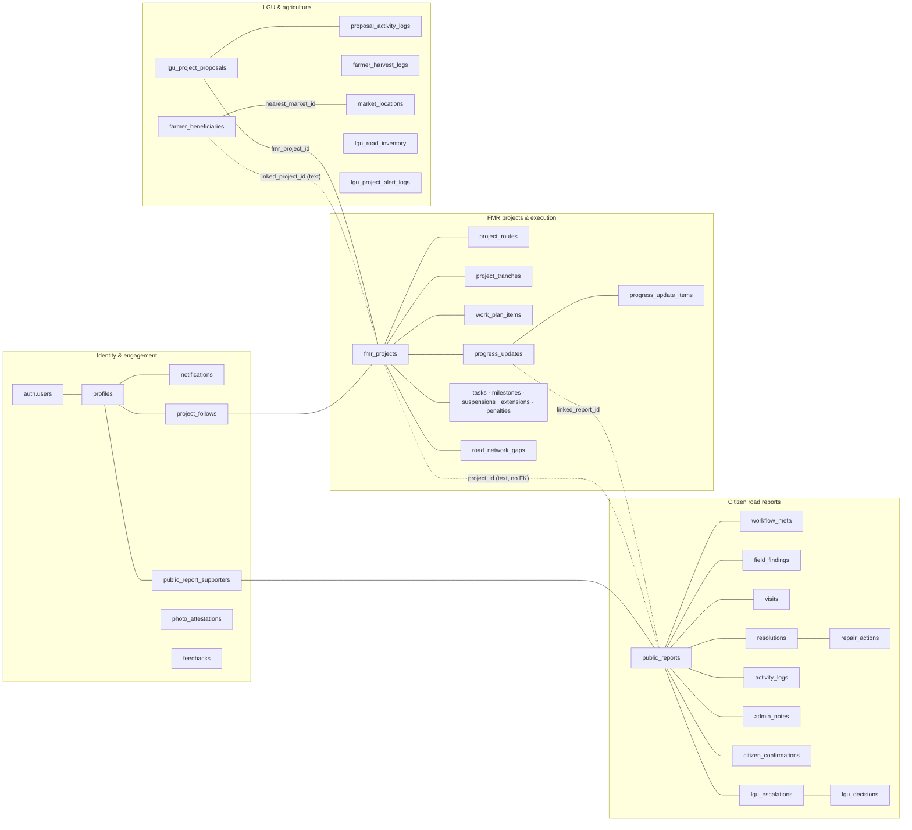
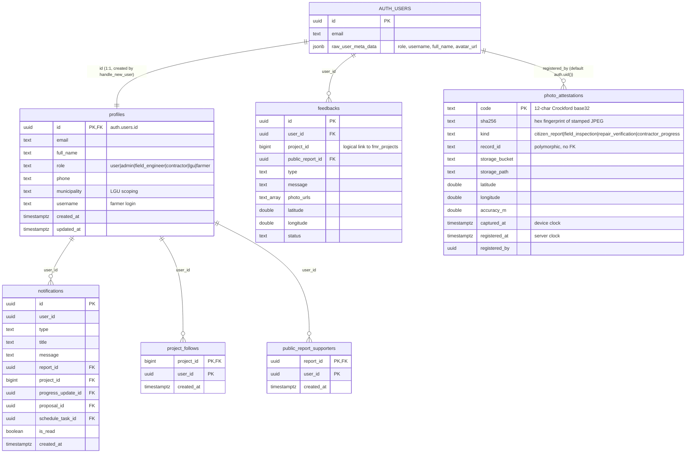
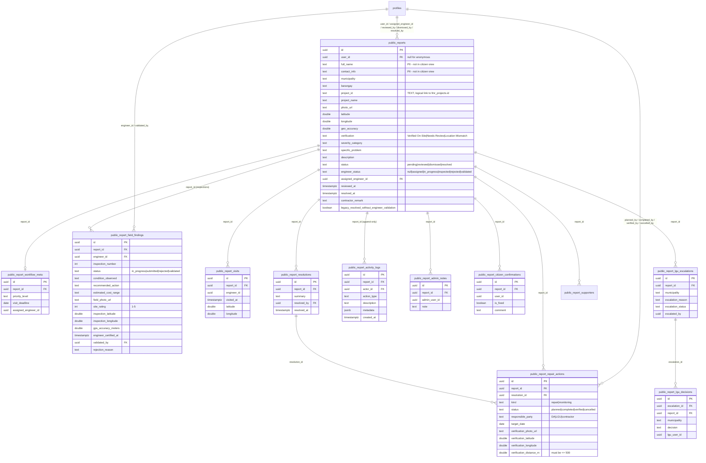
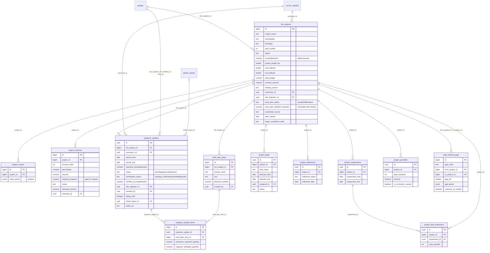
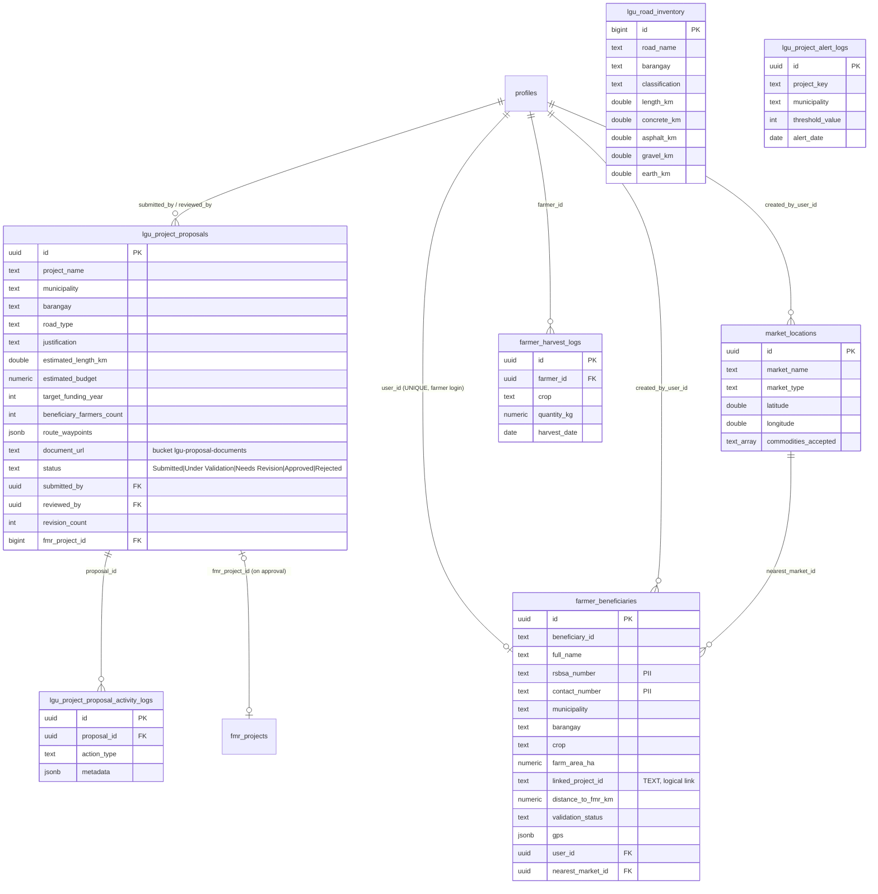

# KalsaTrack — Database Design and ERD

> Part of the KalsaTrack architecture set. See [SYSTEM_ARCHITECTURE.md §0](SYSTEM_ARCHITECTURE.md#0-how-to-read-this-document-set) for the evidence labels.

**Source of truth.** This document is reconstructed from the 80 `supabase_*.sql` scripts in the repository root. **The live database was not inspected.** A table's final shape is its `CREATE TABLE` plus every later `ALTER TABLE … ADD COLUMN`. Seed, data-repair, dry-run and rollback scripts were read for context but do not define structure. Read-only queries to confirm the live schema are in [ARCHITECTURE_REVIEW.md §7](ARCHITECTURE_REVIEW.md#7-read-only-verification-queries).

---

## 1. Database at a glance

| Object | Count | Notes |
|---|---|---|
| Tables (`public`) | 39 | 37 have RLS enabled in scripts. `farmer_fmr_link_backup` is a backup table; `projects` is legacy |
| Views | 9 | Mostly `security_barrier` projections for citizens and the public |
| Functions | ~70 | 35 called by the frontend as RPC; the rest are trigger functions or internal helpers |
| Triggers | 22 (+1 on `auth.users` not in scripts) | See §7 |
| RLS policies | 188 `CREATE POLICY` statements (many later dropped or replaced) | See §9 |
| Storage buckets | 6 | See §8 |
| Extra schema | `maintenance` (private, no grants) | Created by the purge script [supabase_purge_test_public_reports.sql:53-54](../../supabase_purge_test_public_reports.sql#L53-L54) |

### 1.1 Domain map

---

## 2. ERD — Identity and engagement

Evidence: [supabase_complete_fe_setup.sql](../../supabase_complete_fe_setup.sql) (profiles), [supabase_farmer_username_migration.sql](../../supabase_farmer_username_migration.sql), [supabase_public_report_workflow_additive.sql](../../supabase_public_report_workflow_additive.sql) (notifications), [supabase_progress_notifications.sql](../../supabase_progress_notifications.sql) (notification FKs), [supabase_project_follows.sql:30](../../supabase_project_follows.sql#L30), [supabase_report_supporters.sql:31](../../supabase_report_supporters.sql#L31), [supabase_feedbacks_migration.sql](../../supabase_feedbacks_migration.sql), [supabase_photo_attestations.sql:21-37](../../supabase_photo_attestations.sql#L21-L37).

---

## 3. ERD — Citizen road reports

Evidence: [supabase_public_reports_migration.sql](../../supabase_public_reports_migration.sql), [supabase_public_report_workflow_additive.sql](../../supabase_public_report_workflow_additive.sql), [supabase_public_report_workflow_foundation.sql](../../supabase_public_report_workflow_foundation.sql), [supabase_public_report_repair_actions.sql:50-103](../../supabase_public_report_repair_actions.sql#L50-L103), [supabase_lgu_role_additive.sql](../../supabase_lgu_role_additive.sql), [supabase_citizen_fix_confirmation.sql](../../supabase_citizen_fix_confirmation.sql). Status domains: [supabase_public_report_workflow_foundation.sql](../../supabase_public_report_workflow_foundation.sql) (`check (status in ('pending','reviewed','dismissed','resolved'))`).

---

## 4. ERD — FMR projects and execution

Evidence: [supabase_fmr_projects_migration.sql:9-33](../../supabase_fmr_projects_migration.sql#L9-L33), [supabase_fmr_projects_budget_migration.sql](../../supabase_fmr_projects_budget_migration.sql), [supabase_contractor_migration.sql](../../supabase_contractor_migration.sql), [supabase_site_engineer_routing.sql](../../supabase_site_engineer_routing.sql), [supabase_project_tranches_migration.sql](../../supabase_project_tranches_migration.sql), [supabase_work_plan_quantity_reporting_phase1.sql](../../supabase_work_plan_quantity_reporting_phase1.sql), [supabase_progress_certification_migration.sql:52-53](../../supabase_progress_certification_migration.sql#L52-L53), [supabase_project_scheduling_migration.sql](../../supabase_project_scheduling_migration.sql), [supabase_project_compliance_migration.sql](../../supabase_project_compliance_migration.sql), [supabase_leon_road_network_gaps.sql](../../supabase_leon_road_network_gaps.sql).

---

## 5. ERD — LGU and agriculture

Evidence: [supabase_lgu_project_proposals_migration.sql:59-78](../../supabase_lgu_project_proposals_migration.sql#L59-L78), [supabase_farmer_beneficiaries_migration.sql](../../supabase_farmer_beneficiaries_migration.sql), [supabase_farmer_auth_migration.sql](../../supabase_farmer_auth_migration.sql), [supabase_farmers_and_markets.sql](../../supabase_farmers_and_markets.sql), [supabase_farmer_harvest_enrichment.sql](../../supabase_farmer_harvest_enrichment.sql), [supabase_leon_road_inventory.sql](../../supabase_leon_road_inventory.sql), [supabase_lgu_role_additive.sql](../../supabase_lgu_role_additive.sql).

### 5.1 Legacy and auxiliary tables

| Table | Status | Evidence |
|---|---|---|
| `projects` | **Legacy** project table that predates `fmr_projects`. **Still queried** by the admin dashboard and the citizen feedback page | [supabase_fix_projects_rls.sql](../../supabase_fix_projects_rls.sql); [src/pages/Dashboard.jsx:1173,3290,3308](../../src/pages/Dashboard.jsx#L1173); [src/pages/UserFeedback.jsx:316](../../src/pages/UserFeedback.jsx#L316) |
| `farmer_fmr_link_backup` | Snapshot taken before re-linking farmers to the nearest FMR; used by the paired rollback script | [supabase_link_farmers_to_nearest_fmr.sql](../../supabase_link_farmers_to_nearest_fmr.sql), [supabase_link_farmers_to_nearest_fmr_rollback.sql](../../supabase_link_farmers_to_nearest_fmr_rollback.sql) |

### 5.2 Logical relationships without foreign keys

These links are enforced only by application code. They are a data-integrity risk (see [ARCHITECTURE_REVIEW.md](ARCHITECTURE_REVIEW.md#4-findings)).

| Column | Points to | Type mismatch |
|---|---|---|
| `public_reports.project_id` | `fmr_projects.id` | `text` → `bigint` |
| `public_report_lgu_escalations.project_id` | `fmr_projects.id` | `text` → `bigint` |
| `farmer_beneficiaries.linked_project_id` | `fmr_projects.id` | `text` → `bigint` |
| `feedbacks.project_id` | `fmr_projects.id` or legacy `projects.id` | no FK |
| `photo_attestations.record_id` | Report, inspection, repair action or progress update id, depending on `kind` | polymorphic `text` |
| `lgu_project_alert_logs.project_key` | Project | `text` |

---

## 6. RPC function catalogue

All functions below are `SECURITY DEFINER` (they run with the owner's rights and do their own checks) unless noted otherwise. **Defined in** names the latest script by date when a function appears in several scripts.

### 6.1 Citizen report workflow (wrapped by [src/services/publicReportWorkflow.js](../../src/services/publicReportWorkflow.js))

| RPC | Allowed caller | Transition / effect | Defined in |
|---|---|---|---|
| `review_public_report` | Admin | `pending → reviewed`; sets priority | [workflow_rpcs.sql:224](../../supabase_public_report_workflow_rpcs.sql#L224) |
| `assign_public_report_engineer` | Admin | `reviewed` + `engineer_status → assigned` | [:305](../../supabase_public_report_workflow_rpcs.sql#L305) |
| `unassign_public_report_engineer` | Admin | Clears assignment (reason required) | [:409](../../supabase_public_report_workflow_rpcs.sql#L409) |
| `start_public_report_inspection` | Assigned FE | `assigned → in_progress`; opens a finding | [:476](../../supabase_public_report_workflow_rpcs.sql#L476) |
| `submit_public_report_inspection` | Assigned FE | `in_progress → inspected`; finding `submitted` | [:573](../../supabase_public_report_workflow_rpcs.sql#L573) |
| `reject_public_report_inspection` | Admin | `inspected → rejected` | [:717](../../supabase_public_report_workflow_rpcs.sql#L717) |
| `validate_public_report_inspection` | Admin (not the inspecting FE) | `inspected → validated` | [:805](../../supabase_public_report_workflow_rpcs.sql#L805) |
| `dismiss_public_report` | Admin | `pending/reviewed → dismissed` (only before engineer work) | [:894](../../supabase_public_report_workflow_rpcs.sql#L894) |
| `resolve_public_report` | Admin | `→ resolved` (requires validated latest inspection) | [:962](../../supabase_public_report_workflow_rpcs.sql#L962) |
| `update_public_report_workflow_meta` | Admin | Priority and deadline metadata | [rls_hardening.sql](../../supabase_public_report_workflow_rls_hardening.sql) |
| `plan_public_report_repair` | Admin | Creates a repair action (`planned` or `completed`) | [repair_actions.sql:208](../../supabase_public_report_repair_actions.sql#L208) |
| `complete_public_report_repair` | Admin | `planned → completed` | [:345](../../supabase_public_report_repair_actions.sql#L345) |
| `verify_public_report_repair` | Assigned FE / Admin (not the completer) | `completed → verified`; photo + GPS ≤ 500 m | [repair_verification_hardening.sql](../../supabase_public_report_repair_verification_hardening.sql) |
| `cancel_public_report_repair` | Admin | `planned/completed → cancelled` | [repair_actions.sql:534](../../supabase_public_report_repair_actions.sql#L534) |

### 6.2 Project execution and finance

| RPC | Caller (UI) | Effect | Defined in |
|---|---|---|---|
| `save_work_plan_draft` | Admin ([WorkPlanModal.jsx](../../src/components/admin/WorkPlanModal.jsx)) | Upsert Work Plan items; `none → draft` | [work_plan_cost_basis_enhancement.sql](../../supabase_work_plan_cost_basis_enhancement.sql) |
| `finalize_work_plan` | Admin | `draft → finalized`; captures the adoption baseline | [final_workflow_security_hardening.sql:103](../../supabase_final_workflow_security_hardening.sql#L103) ⚠ also in 2 earlier scripts |
| `assign_project_site_engineer` | Admin | Sets `fmr_projects.site_engineer_id`; reroutes pending updates | [site_engineer_routing.sql:134](../../supabase_site_engineer_routing.sql#L134) |
| `submit_progress_update_with_quantities` | Contractor ([ContractorProgressForm.jsx:307](../../src/pages/ContractorProgressForm.jsx#L307)) | Inserts update + items; requires finalized plan | [work_plan_quantity_reporting_phase1.sql:410](../../supabase_work_plan_quantity_reporting_phase1.sql#L410) |
| `certify_progress_with_quantities` | Routed site engineer ([QuantityCertificationReview.jsx](../../src/components/progress/QuantityCertificationReview.jsx)) | Validated quantities → `certified` or `disputed` | [phase1.sql](../../supabase_work_plan_quantity_reporting_phase1.sql) |
| `certify_progress_update_engineer` | FE / Admin ([ProgressCertificationPanel.jsx](../../src/components/progress/ProgressCertificationPanel.jsx)) | Percent-mode certify; dispute sets `rejected` | [final_workflow_security_hardening.sql](../../supabase_final_workflow_security_hardening.sql) ⚠ 3 versions |
| `approve_progress_update_admin` | Admin | `pending → approved` (must be certified) | ⚠ 4 versions; latest [fix_approve_progress_update_ambiguous_reference.sql](../../supabase_fix_approve_progress_update_ambiguous_reference.sql) / [final_workflow_security_hardening.sql:315](../../supabase_final_workflow_security_hardening.sql#L315) |
| `reject_progress_update_admin` | Admin | `pending → rejected` | ⚠ 3 versions |
| `set_billing_hold_admin` | Admin ([BillingHoldControl.jsx](../../src/components/publicReports/BillingHoldControl.jsx)) | Hold or release billing on an update | [project_compliance_migration.sql](../../supabase_project_compliance_migration.sql) |
| `initialize_project_tranches` | Admin | Creates the default tranche schedule | [project_tranches_migration.sql](../../supabase_project_tranches_migration.sql) |
| `release_project_tranche` | Admin | Release gated on verified progress ≥ `required_progress` | [progress_workflow_integrity_migration.sql:335](../../supabase_progress_workflow_integrity_migration.sql#L335) |

### 6.3 Proposals, accounts and utilities

| RPC | Caller | Effect | Defined in |
|---|---|---|---|
| `validate_lgu_project_proposal` | Admin | `→ Approved` | [lgu_project_proposal_actions.sql:21](../../supabase_lgu_project_proposal_actions.sql#L21) |
| `reject_lgu_project_proposal` | Admin | `→ Rejected` | [:64](../../supabase_lgu_project_proposal_actions.sql#L64) |
| `request_lgu_project_proposal_revision` | Admin | `→ Needs Revision` (notes required) | [:106](../../supabase_lgu_project_proposal_actions.sql#L106) |
| `create_field_engineer_profile` | Admin ([Dashboard.jsx:8309](../../src/pages/Dashboard.jsx#L8309)); also called from [FieldEngineerAuth.jsx](../../src/pages/FieldEngineerAuth.jsx) | Sets profile role `field_engineer` | ⚠ 4 versions; latest [final_workflow_security_hardening.sql](../../supabase_final_workflow_security_hardening.sql) |
| `create_contractor_profile` | Admin | Sets role `contractor` | [final_workflow_security_hardening.sql:458](../../supabase_final_workflow_security_hardening.sql#L458) |
| `create_lgu_profile` | Admin | Sets role `lgu` + municipality | [create_lgu_profile_fn.sql](../../supabase_create_lgu_profile_fn.sql) |
| `get_field_engineers_secure` | Admin | Lists field engineers for dropdowns | [complete_fe_setup.sql](../../supabase_complete_fe_setup.sql) |
| `delete_my_account` | Any non-admin | Deletes own data and account | [delete_my_account_rpc.sql](../../supabase_delete_my_account_rpc.sql) |
| `register_photo_attestation` | anon / authenticated | Insert attestation; rejects a code reused for a different hash | [photo_attestations.sql:44](../../supabase_photo_attestations.sql#L44) |
| `verify_photo_attestation` | anon / authenticated | Public lookup (no names or ids) | [photo_attestations.sql:89](../../supabase_photo_attestations.sql#L89) |

### 6.4 Internal helpers (not called by the client)

`_public_report_actor_role`, `_public_report_require_admin`, `_public_report_require_field_engineer`, `_public_report_add_audit`, `_public_report_latest_inspection_id`, `_public_report_distance_m` (great-circle distance), `public_report_current_role`, `public_report_current_municipality`, `current_profile_role`, `is_admin`, `is_admin_jwt`, `calculate_quantity_progress`, `citizen_can_confirm_report`, `citizen_can_support_report`.

---

## 7. Triggers

| Trigger | Table | Timing / event | Purpose |
|---|---|---|---|
| *(not in scripts)* → `handle_new_user()` | `auth.users` | after insert **[Inferred]** | Create `profiles` row; only `farmer` accepted from metadata ([supabase_farmer_profile_trigger_migration.sql:1-32](../../supabase_farmer_profile_trigger_migration.sql#L1-L32)) |
| `trg_protect_privileged_profile_roles` | `profiles` | before insert / update of `role` | Only admins may grant `admin` or `field_engineer` |
| `trg_public_report_prepare_citizen_insert` | `public_reports` | before insert | Non-admin inserts forced to `pending`; workflow fields cleared; `user_id := auth.uid()`; `Verified On-Site` downgraded |
| `trg_public_report_direct_update_guard` | `public_reports` | before update | Blocks direct edits of workflow fields; contractors may only change remarks |
| `trg_public_report_state_invariant` | `public_reports` | before insert / update | Enforces valid `status` × `engineer_status` combinations |
| `trg_prepare_public_report_field_finding` | `public_report_field_findings` | before insert | Numbers inspections, sets defaults |
| `trg_touch_public_report_field_finding_updated_at` | `public_report_field_findings` | before update | `updated_at` |
| `trg_normalize_public_report_activity_log` | `public_report_activity_logs` | before insert | Normalises actor fields |
| `trg_prevent_public_report_activity_log_update` / `_delete` | `public_report_activity_logs` | before update / delete | **Append-only audit log** |
| `trg_repair_actions_touch` | `public_report_repair_actions` | before update | `updated_at` |
| `report_supporter_notify` | `public_report_supporters` | after insert | Milestone notification to the reporter |
| `citizen_confirmation_notify` | `public_report_citizen_confirmations` | after insert / update of `is_fixed` | Notify staff when a citizen says "not fixed" |
| `trg_route_progress_update` | `progress_updates` | before insert | Route to the project's site engineer; reject if none |
| `trg_enforce_site_engineer_certification` | `progress_updates` | before update | Only the routed engineer may certify |
| `trg_enforce_stored_quantity_progress` | `progress_updates` | before update of certification | Certified updates need validated quantities on every item |
| `trg_protect_approved_progress_update` | `progress_updates` | before update | Approved updates are immutable |
| `trg_notify_progress_update_events` | `progress_updates` | after insert / update | Notify contractor, engineer and admin |
| `trg_sync_reported_quantity_progress` | `progress_update_items` | after insert / update of quantity | Recompute reported percent |
| `trg_prevent_finalized_work_plan_item_mutation` | `work_plan_items` | before insert / update / delete | Lock after finalization |
| `trg_protect_work_plan_adoption_baseline` | `fmr_projects` | before insert / update of baseline | Baseline set only at finalization; immutable afterwards |
| `trg_notify_project_followers` | `fmr_projects` | after update of accomplishment etc. | Notify followers |
| `trg_notify_project_assignment_events` | `fmr_projects` | after update of `contractor_id`, `site_engineer_id` | Notify assignees |

---

## 8. Storage buckets

| Bucket | Public | Contents | Write rule (latest script) | Evidence |
|---|---|---|---|---|
| `public-report-photos` | Yes | Citizen report photos, inspection and repair photos | **anon and authenticated** may upload (supports anonymous reports); public read | [supabase_public_reports_migration.sql:106-128](../../supabase_public_reports_migration.sql#L106-L128) |
| `progress-photos` | Yes **[Inferred]** | Contractor progress photos | `progress_photos_insert_own` (own folder) | Bucket insert commented out at [supabase_contractor_migration.sql:127](../../supabase_contractor_migration.sql#L127); policies in [supabase_final_workflow_security_hardening.sql](../../supabase_final_workflow_security_hardening.sql) |
| `farmer-harvest-photos` | **No** | Harvest photos | Own folder; staff can read | [supabase_farmer_harvest_photos_storage.sql:18](../../supabase_farmer_harvest_photos_storage.sql#L18) |
| `feedback-photos` | Yes | Feedback attachments | Authenticated | [supabase_feedbacks_migration.sql:74](../../supabase_feedbacks_migration.sql#L74) |
| `avatars` | Yes | Profile photos (2 MB, jpeg/png/webp) | Own folder `avatars/<uid>/` | [supabase_profile_avatars.sql:11-45](../../supabase_profile_avatars.sql#L11-L45) |
| `lgu-proposal-documents` | **No** | Proposal attachments; read through 1-hour signed URLs | LGU / admin | [supabase_lgu_project_proposals_migration.sql:135](../../supabase_lgu_project_proposals_migration.sql#L135); [src/components/admin/LguProposalsTab.jsx:283](../../src/components/admin/LguProposalsTab.jsx#L283) |

---

## 9. Row-Level Security summary

### 9.1 Patterns in use

| Pattern | Helper | Example |
|---|---|---|
| Admin-only | `current_profile_role() = 'admin'` / `is_admin()` | `fmr_projects_insert_admin` |
| Owner | `user_id = auth.uid()` | `notifications_select_own`, `project_follows_*` |
| Assigned engineer | `assigned_engineer_id = auth.uid()` | `public_reports_select_assigned_field_engineer` |
| Contractor's projects | join through `fmr_projects.contractor_id` | `public_reports_select_contractor_projects` |
| Municipality scoping (LGU) | `public_report_current_municipality()` | `public_reports_select_lgu_municipality`, [supabase_lgu_analytics_rls_scoping.sql](../../supabase_lgu_analytics_rls_scoping.sql) |
| Public projection | `security_barrier` view + `GRANT SELECT … TO anon` | `public_reports_citizen_view` |
| Constrained insert | `WITH CHECK` on initial state | `public_reports_insert_citizen_initial` |

### 9.2 Views

| View | Exposed to | Purpose | Evidence |
|---|---|---|---|
| `public_reports_citizen_view` | anon, authenticated | Reports without reporter name or contact; milestone timestamps only; `is_current_user_report` flag | [rls_hardening.sql:209-317](../../supabase_public_report_workflow_rls_hardening.sql#L209-L317) |
| `public_report_field_findings_citizen_view` | anon, authenticated | Inspection outcome without internal notes | [:282,318](../../supabase_public_report_workflow_rls_hardening.sql#L282) |
| `public_report_resolutions_citizen_view` | anon, authenticated | Resolution summary without resolver identity | [:302,319](../../supabase_public_report_workflow_rls_hardening.sql#L302) |
| `public_report_repair_actions_citizen_view` | anon, authenticated | Repair follow-up status | [repair_actions.sql:160-179](../../supabase_public_report_repair_actions.sql#L160-L179) |
| `public_report_support_counts` | authenticated | Aggregate "me too" counts | [report_supporters.sql:93-106](../../supabase_report_supporters.sql#L93-L106) |
| `project_follow_counts` | authenticated | Follower counts | [project_follows.sql:65-76](../../supabase_project_follows.sql#L65-L76) |
| `feedbacks_community_view` | authenticated | Community feedback without the author's e-mail | [feedbacks_community_view.sql:34-56](../../supabase_feedbacks_community_view.sql#L34-L56) |
| `public_project_progress` | authenticated | Project progress for citizens | [public_project_progress.sql:26-43](../../supabase_public_project_progress.sql#L26-L43) |
| `public_report_state_violations` | (diagnostic) | Lists rows that break the state invariant; RPC install aborts if not empty | [legacy_state_cleanup.sql:158](../../supabase_public_report_legacy_state_cleanup.sql#L158) |

### 9.3 Policies broader than the workflow intends (latest script state)

| Table | Policy | Effect | Evidence |
|---|---|---|---|
| `project_routes` | `"Anyone can insert/update/delete project_routes"` | **anon** can rewrite any route geometry | [supabase_project_routes_migration.sql:34-45](../../supabase_project_routes_migration.sql#L34-L45) |
| `lgu_project_proposals`, `…_activity_logs`, `lgu_project_alert_logs` | `*_rw … for all to authenticated using (true)` | Any signed-in user, including citizens, can read and change any proposal, bypassing the review RPCs | [supabase_lgu_project_proposals_migration.sql:112-118](../../supabase_lgu_project_proposals_migration.sql#L112-L118), [supabase_lgu_role_additive.sql:77](../../supabase_lgu_role_additive.sql#L77) |
| `road_network_gaps` | `road_network_gaps_write_authenticated` (ALL, `true`) | Any signed-in user can edit gap analysis | [supabase_leon_road_network_gaps.sql:108-112](../../supabase_leon_road_network_gaps.sql#L108-L112) |
| `profiles` | `"Users can update own profile" … OR is_admin_jwt()`; `"Admin can delete profiles" USING (is_admin_jwt())` | Trusts client-editable `user_metadata.role` | [supabase_fix_missing_fe_profiles.sql:57-71](../../supabase_fix_missing_fe_profiles.sql#L57-L71) |
| `notifications` | `notifications_insert_authenticated` (`auth.uid() is not null`) | Any user can create a notification for any other user | [rls_hardening.sql:535-537](../../supabase_public_report_workflow_rls_hardening.sql#L535-L537) |
| `projects` (legacy) | `"Authenticated …"` insert / update / delete | Any signed-in user can modify | [supabase_fix_projects_rls.sql](../../supabase_fix_projects_rls.sql) |

Examples of policies correctly superseded: `progress_updates_permissive` was created in [supabase_progress_updates_rls_fix.sql:14](../../supabase_progress_updates_rls_fix.sql#L14) and dropped in [supabase_work_plan_quantity_reporting_phase3_rls.sql](../../supabase_work_plan_quantity_reporting_phase3_rls.sql). The `public_report_*_rw` policies were dropped in [supabase_public_report_workflow_rls_hardening.sql](../../supabase_public_report_workflow_rls_hardening.sql). The `fmr_projects` "Authenticated users can …" write policies were replaced by admin-only ones in [supabase_final_workflow_security_hardening.sql:9-35](../../supabase_final_workflow_security_hardening.sql#L9-L35).
