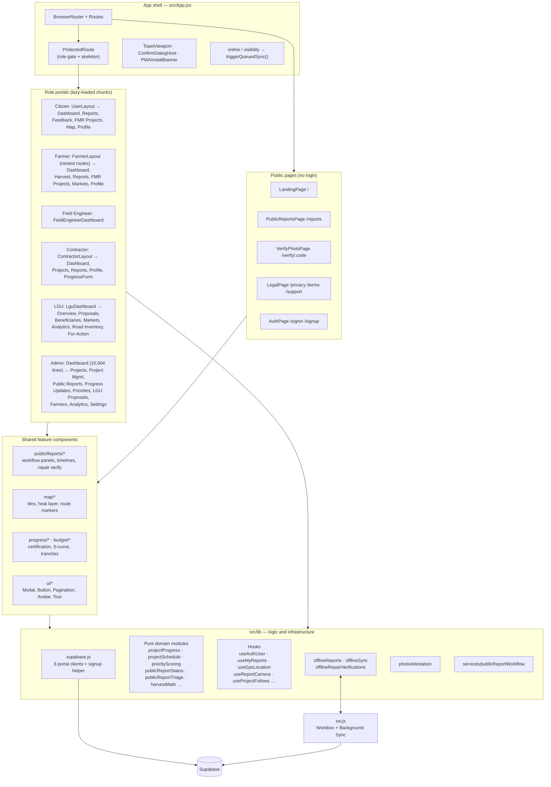
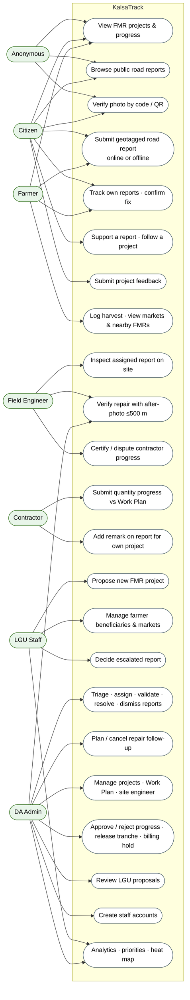
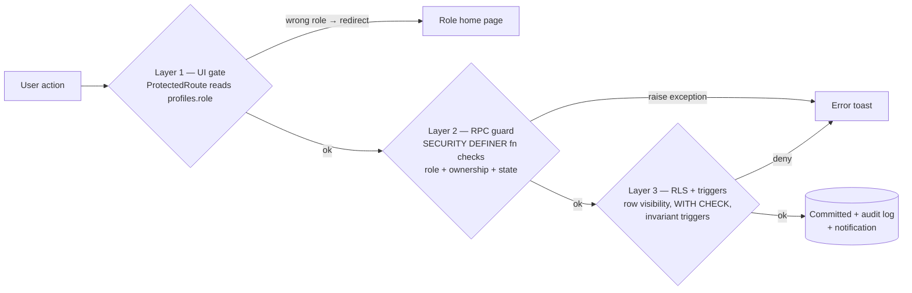
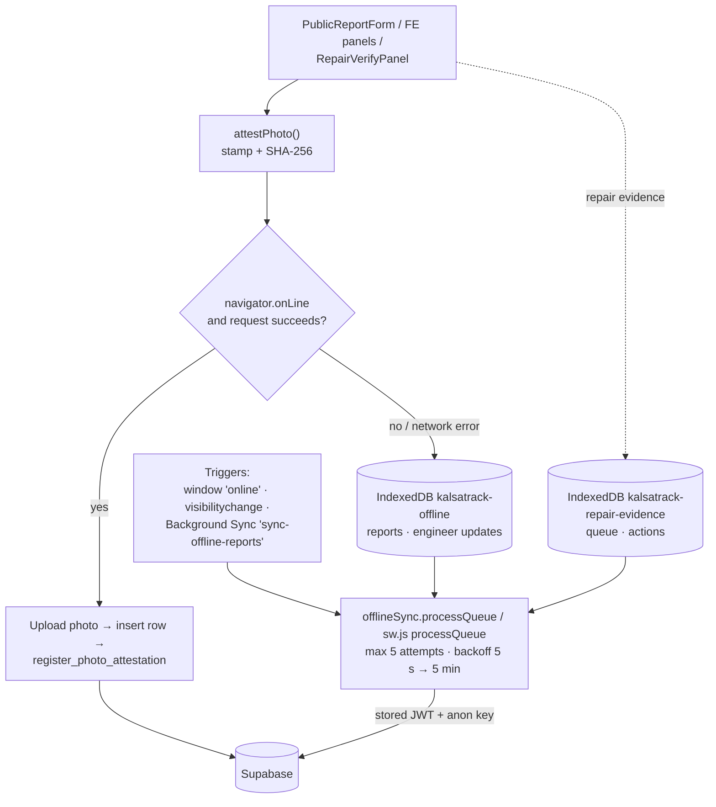

# KalsaTrack — Software Architecture

> Part of the KalsaTrack architecture set. See [SYSTEM_ARCHITECTURE.md §0](SYSTEM_ARCHITECTURE.md#0-how-to-read-this-document-set) for the evidence labels **[Verified]**, **[Inferred]** and **[Recommendation]**.

---

## 1. Technology stack

| Layer | Technology (version from `package.json`) | Role in the system |
|---|---|---|
| Language | JavaScript (ES modules, JSX); SQL / PL/pgSQL | No TypeScript in `src/` **[Verified]** |
| UI framework | React `^19.2.0`, React DOM `^19.2.0` | Component rendering |
| Routing | React Router DOM `^7.13.0` (`BrowserRouter`) | Client-side routing, nested farmer routes |
| Styling | Tailwind CSS `^4.1.18` via `@tailwindcss/postcss` | Utility-first styling ([tailwind.config.js](../../tailwind.config.js), [postcss.config.js](../../postcss.config.js)) |
| Icons | lucide-react `^1.52.0` | Iconography |
| Charts | Recharts `^3.8.0` | Analytics dashboards, S-curves |
| Maps | Leaflet `^1.9.4`, react-leaflet `^5.0.0`, leaflet.heat `^0.2.0` | Project routes, report markers, heat maps |
| QR codes | qrcode `^1.5.4` | Photo-attestation QR stamped on photos ([src/lib/photoAttestation.js:19](../../src/lib/photoAttestation.js#L19)) |
| Backend SDK | @supabase/supabase-js `^2.95.3` | Auth, PostgREST, RPC, Storage, Realtime |
| Build tool | Vite `^7.3.1`, @vitejs/plugin-react `^5.1.1` | Dev server, production bundling, code splitting |
| PWA | vite-plugin-pwa `^1.2.0`, workbox-window `^7.4.0`; Workbox modules in `src/sw.js` | Precaching, offline fallback, Background Sync |
| Testing | Vitest `^5.0.3`, jsdom, @testing-library/react, fake-indexeddb | Unit and hook tests (19 files in [src/lib/__tests__/](../../src/lib/__tests__/), plus component tests) |
| Linting | ESLint 9 + react-hooks + react-refresh plugins | [eslint.config.js](../../eslint.config.js) |
| Backend platform | Supabase: PostgreSQL, GoTrue Auth, PostgREST, Storage, Realtime | All server-side behaviour |
| Hosting | Vercel (static) | [vercel.json](../../vercel.json) |

---

## 2. Architecture style and justification

### 2.1 Style

**[Verified]** KalsaTrack combines four styles:

1. **Backend-as-a-Service (BaaS) / serverless two-tier.** The SPA calls Supabase directly. There is no application server, API layer or Edge Function.
2. **"Smart database".** Business rules are in PostgreSQL: `SECURITY DEFINER` RPC functions implement state transitions, triggers enforce invariants and write audit or notification rows, and RLS decides row visibility.
3. **Role-partitioned SPA ("portals").** One codebase, six role portals, each with its own route prefix, layout, login page and **isolated auth session**.
4. **Offline-first PWA** for field capture: IndexedDB queue, service worker and Background Sync.

### 2.2 Justification (trade-off analysis)

| Driver | Why this style fits | Cost accepted |
|---|---|---|
| Small team, thesis timeline | No server to build, host, patch or scale; Supabase provides auth, storage and realtime | Strong vendor coupling to Supabase |
| Strong integrity for public-money workflows | Rules in the database apply to **every** client, including someone calling the REST API directly with the public anon key | Logic is harder to test (no SQL test suite) and harder to version (loose scripts) |
| Transparency to anonymous public | `anon` role plus `security_barrier` citizen views expose curated columns only | Every new column needs a deliberate decision about exposure |
| Rural connectivity | PWA with offline queue lets citizens and engineers capture evidence without a signal | Queued items carry a stored JWT that can expire before replay; duplicate-submission handling needed |
| Several roles on shared devices (DA office) | Per-portal session storage keys let several portals stay signed in at once | Six Supabase clients in memory; more complex auth reasoning |

---

## 3. Frontend architecture

### 3.1 Source layout

| Path | Contents | Count |
|---|---|---|
| [src/main.jsx](../../src/main.jsx), [src/App.jsx](../../src/App.jsx) | Bootstrap, router, global hosts (toasts, confirm dialog, PWA banner), online/visibility sync triggers | — |
| [src/pages/](../../src/pages/) | Route-level screens (one per portal page plus auth pages) | 31 |
| [src/components/](../../src/components/) | Layouts and sidebars, plus feature folders: `admin/`, `lgu/`, `publicReports/`, `map/`, `progress/`, `budget/`, `farmer/`, `profile/`, `ui/` | ~100 |
| [src/lib/](../../src/lib/) | Supabase clients, pure domain logic, React hooks, offline queue, photo attestation | 55 |
| [src/services/publicReportWorkflow.js](../../src/services/publicReportWorkflow.js) | Thin wrapper over the 14 public-report workflow RPCs | 1 |
| [src/data/](../../src/data/) | Static Leon barangay list, road inventory JSON, Iloilo locations | 3 |
| [src/sw.js](../../src/sw.js) | Custom service worker (Workbox) | 1 |

### 3.2 Application component diagram

### 3.3 Key frontend design decisions

| Decision | Implementation | Evidence |
|---|---|---|
| **Route-level code splitting** | Every portal page is `lazyPage(() => import(...))`; a citizen never downloads the admin bundle | [src/App.jsx:10-37](../../src/App.jsx#L10-L37) |
| **Deploy-safe lazy loading** | `lazyPage` retries a failed chunk once, then reloads the app a single time (guarded by a `sessionStorage` flag) | [src/lib/lazyPage.js](../../src/lib/lazyPage.js) |
| **Per-portal session isolation** | Separate `createClient` per portal with `storageKey: 'kt-<role>-session'` | [src/lib/supabase.js:23-41](../../src/lib/supabase.js#L23-L41) |
| **Admin creates users without losing their session** | `supabaseAdmin` client with `persistSession: false` used for `signUp` | [src/lib/supabase.js:50-57](../../src/lib/supabase.js#L50-L57) |
| **Pure, testable domain logic** | Calculations live in framework-free modules with unit tests | e.g. [src/lib/reportSubmission.js:1-5](../../src/lib/reportSubmission.js#L1-L5) |
| **Global UI services without context providers** | Pub/sub toast store and confirm-dialog host | [src/lib/toast.js](../../src/lib/toast.js), [src/lib/confirm.js](../../src/lib/confirm.js) |
| **Realtime freshness** | ≥15 `postgres_changes` channels (admin dashboard alone subscribes to 9) | `.channel(` in [src/pages/Dashboard.jsx](../../src/pages/Dashboard.jsx), [src/components/NotificationBell.jsx](../../src/components/NotificationBell.jsx) |
| **State management** | Local component state and custom hooks; **no** global store (Redux, Zustand, React Query) | absence across `package.json` and `src/` **[Verified]** |

---

## 4. Backend architecture (Supabase as the application tier)

### 4.1 Responsibilities

| Responsibility | Mechanism | Representative evidence |
|---|---|---|
| Identity and sessions | Supabase Auth (email + password; JWT) | `signInWithPassword`, `signUp`, `resetPasswordForEmail` in [src/pages/AuthPage.jsx:134-174](../../src/pages/AuthPage.jsx#L134-L174) |
| Profile bootstrap | `handle_new_user()` trigger on `auth.users` creates a `profiles` row; only `farmer` or `user` can be self-assigned | [supabase_farmer_profile_trigger_migration.sql:11-32](../../supabase_farmer_profile_trigger_migration.sql#L11-L32) |
| Workflow state machines | `SECURITY DEFINER` RPCs check role, ownership and current state, then mutate and audit | [supabase_public_report_workflow_rpcs.sql](../../supabase_public_report_workflow_rpcs.sql), [supabase_public_report_repair_actions.sql](../../supabase_public_report_repair_actions.sql), [supabase_final_workflow_security_hardening.sql](../../supabase_final_workflow_security_hardening.sql) |
| Data invariants | BEFORE triggers (state invariant, direct-update guard, approved-update immutability, finalized Work Plan lock, privileged-role protection) | see [DATABASE_ERD.md §7](DATABASE_ERD.md#7-triggers) |
| Row visibility | 188 `CREATE POLICY` statements across 37 RLS-enabled tables plus `storage.objects` | see [DATABASE_ERD.md §9](DATABASE_ERD.md#9-row-level-security-summary) |
| Public projection | `security_barrier` citizen views granted to `anon` | [supabase_public_report_workflow_rls_hardening.sql:209-319](../../supabase_public_report_workflow_rls_hardening.sql#L209-L319) |
| Notifications | Triggers insert into `notifications`; clients subscribe via Realtime | `notify_*` functions in [supabase_progress_notifications.sql](../../supabase_progress_notifications.sql), [supabase_project_follows.sql](../../supabase_project_follows.sql), [supabase_report_supporters.sql](../../supabase_report_supporters.sql), [supabase_citizen_fix_confirmation.sql](../../supabase_citizen_fix_confirmation.sql) |
| File storage | 6 buckets with per-folder ownership policies | see [DATABASE_ERD.md §8](DATABASE_ERD.md#8-storage-buckets) |

### 4.2 Client ↔ database interaction patterns

The frontend uses three distinct patterns. Recognising which one a feature uses is the key to reasoning about its security.

| Pattern | When used | Security enforced by | Examples |
|---|---|---|---|
| **A. Direct table CRUD** (`.from(t).select/insert/update`) | Reads everywhere; simple writes (markets, harvest logs, beneficiaries, feedback, follows, supporters) | RLS only | `market_locations`, `farmer_harvest_logs`, `project_follows` |
| **B. RPC command** (`.rpc(fn, args)`) | Every workflow transition with business rules | Function body (role + state checks) **and** RLS on anything not `SECURITY DEFINER` | `assign_public_report_engineer`, `certify_progress_with_quantities`, `release_project_tranche` |
| **C. Insert + trigger** | Citizen report submission | RLS `WITH CHECK` **and** `BEFORE INSERT` trigger that overwrites privileged fields | `public_reports` insert ([supabase_public_report_workflow_rls_hardening.sql:77-121,369-385](../../supabase_public_report_workflow_rls_hardening.sql#L77-L121)) |

**[Verified]** 35 distinct RPCs are called from `src/` (catalogue in [DATABASE_ERD.md §6](DATABASE_ERD.md#6-rpc-function-catalogue)).

---

## 5. User roles and access boundaries

### 5.1 Roles

**[Verified]** `profiles.role` is constrained to `user | admin | field_engineer | contractor | lgu | farmer` (latest form of `profiles_role_check`, which also allows `NULL`). `ProtectedRoute` normalises the role and redirects mismatches to each role's home portal ([src/components/ProtectedRoute.jsx:14-19,111-136](../../src/components/ProtectedRoute.jsx#L111-L136)).

| Role | Login route | Home | How the account is created | Evidence |
|---|---|---|---|---|
| Anonymous | — | `/`, `/reports`, `/verify/:code` | — | [src/App.jsx:87-98](../../src/App.jsx#L87-L98) |
| Citizen (`user`) | `/signin` | `/user` | Self sign-up (`AuthPage`, `signUp`) | [src/pages/AuthPage.jsx:174](../../src/pages/AuthPage.jsx#L174) |
| Farmer | `/farmer/login` (username or e-mail) | `/farmer` | Provisioned by LGU staff: username → synthetic e-mail `<username>@farmer.kalsatrack.internal` | [src/lib/farmerAuth.js](../../src/lib/farmerAuth.js), [src/pages/LguDashboard.jsx:990-1023](../../src/pages/LguDashboard.jsx#L990-L1023) |
| Field Engineer | `/field-engineer/login` | `/field-engineer` | Admin: `signUp` (helper client) then `create_field_engineer_profile` RPC | [src/pages/Dashboard.jsx:8285-8322](../../src/pages/Dashboard.jsx#L8285-L8322) |
| Contractor | `/contractor/login` | `/contractor` | Admin: `signUp` then `create_contractor_profile` RPC | [src/pages/Dashboard.jsx:8458](../../src/pages/Dashboard.jsx#L8458) |
| LGU | `/lgu/login` | `/lgu` | Admin: `signUp` then `create_lgu_profile` RPC | [src/pages/Dashboard.jsx:8632](../../src/pages/Dashboard.jsx#L8632) |
| Admin (DA) | `/admin` | `/dashboard` | Not created from the app. **[Inferred]** Seeded manually in the database; `protect_privileged_profile_roles` blocks non-admins from granting `admin` or `field_engineer` | [supabase_final_workflow_security_hardening.sql:430-454](../../supabase_final_workflow_security_hardening.sql#L430-L454) |

### 5.2 Use case diagram

Mermaid has no native UML use-case notation, so actors are shown as rounded nodes and use cases as stadium nodes.

### 5.3 Role-based access and permission matrix

C = create, R = read, U = update, D = delete, **RPC** = only through a guarded function, **own** = only rows the user owns, **muni** = only rows in the LGU user's municipality, **assigned** = only rows assigned to that engineer or contractor. The matrix reflects the **latest** policy definitions in the repository scripts. ⚠ marks a policy that is broader than the workflow intends (see [ARCHITECTURE_REVIEW.md](ARCHITECTURE_REVIEW.md#4-findings)).

| Resource | Anon | Citizen | Farmer | Field Eng. | Contractor | LGU | Admin |
|---|---|---|---|---|---|---|---|
| `public_reports` (base) | C (+ photo upload) | C, R(own via view) | C, R(own via view) | R(assigned) | R(assigned project), U(remark only) | R(muni) | R, workflow via RPC |
| `public_reports_citizen_view` | R | R | R | R | R | R | R |
| Report workflow transitions | — | — | — | RPC (start/submit inspection) | — | — | RPC (review, assign, validate, reject, dismiss, resolve) |
| Repair actions | — | — | — | RPC verify (assigned) | — | — | RPC plan/complete/verify/cancel |
| Citizen fix confirmation | — | C/R(own) | C/R(own) | — | — | — | R |
| LGU escalations / decisions | — | R(decisions on own report) | — | — | — | R/U(muni), C decision | C escalation, R |
| `fmr_projects` | — | R | R | R | R(own) | R | C/U/D |
| `work_plan_items` | — | — | — | R(authorized) | R(authorized) | — | RPC save/finalize |
| `progress_updates` (+ items) | — | — | — | RPC certify (routed engineer) | RPC submit (assigned) | — | RPC approve/reject |
| `project_tranches` | R | R | R | R | R | R | C/U/D, RPC release |
| `project_routes` | ⚠ C/R/U/D | ⚠ C/R/U/D | ⚠ | ⚠ | ⚠ | ⚠ | C/R/U/D |
| `road_network_gaps` | — | R, ⚠ write | R, ⚠ write | R, ⚠ write | R, ⚠ write | R, write | R, write |
| `lgu_project_proposals` (+ logs) | — | ⚠ C/R/U/D | ⚠ | ⚠ | ⚠ | C/R/U | RPC validate/reject/revise |
| `farmer_beneficiaries` | — | — | R/U(self) | — | — | C, R/U(muni) | C/R/U/D |
| `farmer_harvest_logs` | — | — | C/R/U/D(own) | — | — | R(muni), C/U | all |
| `market_locations` | — | R | R | R | R | C, U(own) | C/R/U/D |
| `notifications` | — | R/U/D(own), ⚠ C(any) | same | same | same | same | same |
| `profiles` | — | R(scoped), U(own) ⚠ | same | same | same | same | R/U/D |
| `photo_attestations` | RPC verify | RPC register/verify | same | same | same | same | same |

---

## 6. Authentication and authorization

### 6.1 Authentication

| Aspect | Implementation | Evidence |
|---|---|---|
| Method | Supabase e-mail/password (`signInWithPassword`); farmers type a username mapped to a synthetic e-mail | [src/pages/AuthPage.jsx:168](../../src/pages/AuthPage.jsx#L168), [src/lib/farmerAuth.js:20-30](../../src/lib/farmerAuth.js#L20-L30) |
| Session storage | `localStorage`, one key per portal (`sb-…` default, `kt-admin-session`, `kt-lgu-session`, `kt-field-engineer-session`, `kt-contractor-session`, `kt-farmer-session`) | [src/lib/supabase.js](../../src/lib/supabase.js) |
| Password reset | `resetPasswordForEmail` (citizen portal) | [src/pages/AuthPage.jsx:134](../../src/pages/AuthPage.jsx#L134) |
| Error messages | Mapped to user-safe text; does not reveal whether an e-mail exists (prevents account enumeration) | [src/lib/authErrors.js:1-12](../../src/lib/authErrors.js#L1-L12) |
| Account deletion | `delete_my_account()` RPC (blocked for admins) | [supabase_delete_my_account_rpc.sql](../../supabase_delete_my_account_rpc.sql) |
| MFA, OAuth, SSO | Not implemented **[Verified]** (no such calls in `src/`) | — |

### 6.2 Authorization — three layers

| Layer | Trust level | Notes |
|---|---|---|
| **1. `ProtectedRoute`** | **UX only — not a security boundary.** Anyone holding the anon key can call the API directly. | Falls back to role `user` on profile-query error ([src/components/ProtectedRoute.jsx:86-96](../../src/components/ProtectedRoute.jsx#L86-L96)), which fails safe |
| **2. RPC guards** | Authoritative for workflows. Helpers: `_public_report_require_admin`, `_public_report_require_field_engineer`, `current_profile_role()`, `is_admin()` | [supabase_public_report_workflow_rpcs.sql:81-133](../../supabase_public_report_workflow_rpcs.sql#L81-L133) |
| **3. RLS and triggers** | Authoritative for direct table access. Segregation-of-duties rules: an engineer cannot validate their own inspection, the person who completed a repair cannot verify it, a contractor cannot certify their own submission | [supabase_public_report_workflow_rpcs.sql:851](../../supabase_public_report_workflow_rpcs.sql#L851), [supabase_public_report_repair_actions.sql:482](../../supabase_public_report_repair_actions.sql#L482), [supabase_progress_workflow_integrity_migration.sql:140](../../supabase_progress_workflow_integrity_migration.sql#L140) |

**[Verified] Role sources.** The authoritative role is `profiles.role`. Two legacy helpers also read the **client-editable** JWT `user_metadata`:

- `is_admin_jwt()` ([supabase_complete_fe_setup.sql:83-90](../../supabase_complete_fe_setup.sql#L83-L90))
- the fallback branch of `current_profile_role()` when no profile role exists ([supabase_farmer_beneficiaries_migration.sql:50-62](../../supabase_farmer_beneficiaries_migration.sql#L50-L62))

This is the most significant authorization weakness found; see [ARCHITECTURE_REVIEW.md F-01](ARCHITECTURE_REVIEW.md#4-findings).

---

## 7. Data validation

Validation is applied at both ends. The database copy is authoritative.

| Concern | Client-side | Server-side (authoritative) |
|---|---|---|
| Report completeness | `validateReportInput`: category, description, photo, project, GPS ([src/lib/reportSubmission.js:76-84](../../src/lib/reportSubmission.js#L76-L84)) | RLS `WITH CHECK` requires `status='pending'` and no workflow fields ([supabase_public_report_workflow_rls_hardening.sql:369-385](../../supabase_public_report_workflow_rls_hardening.sql#L369-L385)) |
| On-site verification label | `computeVerification`: ≤100 m gives `Verified On-Site` ([src/lib/reportSubmission.js:67-73](../../src/lib/reportSubmission.js#L67-L73)) | Trigger **downgrades** a citizen's `Verified On-Site` to `Needs Review` ([…rls_hardening.sql:101-103](../../supabase_public_report_workflow_rls_hardening.sql#L101-L103)) |
| Inspection submission | Form checks in [FieldEngineerWorkflowPanel.jsx](../../src/components/publicReports/FieldEngineerWorkflowPanel.jsx) | Required condition, action and photo; rating 1–5; lat/lng ranges; certification flag ([supabase_public_report_workflow_rpcs.sql:599-633](../../supabase_public_report_workflow_rpcs.sql#L599-L633)) |
| Repair verification | GPS capture plus photo ([RepairVerifyPanel.jsx](../../src/components/publicReports/RepairVerifyPanel.jsx)) | Photo and GPS required; within **500 m** of the report ([supabase_public_report_repair_verification_hardening.sql:58,133-138](../../supabase_public_report_repair_verification_hardening.sql#L58)) |
| Progress quantities | Contractor form ([ContractorProgressForm.jsx](../../src/pages/ContractorProgressForm.jsx)) | Finalized Work Plan required, valid period, remarks, certification acknowledgement ([supabase_work_plan_quantity_reporting_phase1.sql:436-473](../../supabase_work_plan_quantity_reporting_phase1.sql#L436-L473)); certified accomplishment 0–100 |
| Work Plan items | [WorkPlanModal.jsx](../../src/components/admin/WorkPlanModal.jsx) | Name required, quantity > 0, unit ≤ 50 chars, no duplicates ([…phase1.sql:244-265](../../supabase_work_plan_quantity_reporting_phase1.sql#L244-L265)) |
| Tranche release | — | Requires project verified progress ≥ `required_progress` ([supabase_progress_workflow_integrity_migration.sql:376](../../supabase_progress_workflow_integrity_migration.sql#L376)) |
| State invariants | Status helpers in [src/lib/publicReportStatus.js](../../src/lib/publicReportStatus.js) | `public_report_enforce_state_invariant` trigger ([…rls_hardening.sql:167-203](../../supabase_public_report_workflow_rls_hardening.sql#L167-L203)) |
| Photo codes | Crockford base32, 12 chars | `CHECK (code ~ '^[0-9A-HJKMNP-TV-Z]{12}$')`, `sha256` hex check ([supabase_photo_attestations.sql:22-23](../../supabase_photo_attestations.sql#L22-L23)) |
| Storage uploads | Avatar resized to 320×320 JPEG | `avatars` bucket: 2 MB, jpeg/png/webp only ([supabase_profile_avatars.sql:11-17](../../supabase_profile_avatars.sql#L11-L17)) |

---

## 8. Error handling

| Mechanism | Behaviour | Evidence |
|---|---|---|
| Database exceptions as user messages | RPCs `raise exception '<plain sentence>'`; the client shows `error.message` in a toast | e.g. "The person who recorded the work as complete cannot also verify it" ([supabase_public_report_repair_actions.sql:482](../../supabase_public_report_repair_actions.sql#L482)) |
| Toast store | 4 severities with different durations; at most 4 visible | [src/lib/toast.js:16-18](../../src/lib/toast.js#L16-L18) |
| Auth error mapping | Known Supabase messages mapped to friendly text; generic fallback | [src/lib/authErrors.js](../../src/lib/authErrors.js) |
| Network failures during submit | `isNetworkFailure` routes the submission to the offline queue instead of losing it | [src/components/PublicReportForm.jsx:247-248](../../src/components/PublicReportForm.jsx#L247-L248) |
| Offline retries | Up to 5 attempts, exponential backoff from 5 s to a 5 min cap | [src/lib/offlineSync.js:11-13](../../src/lib/offlineSync.js#L11-L13) |
| Chunk-load failures after deploy | Retry once, then a single reload | [src/lib/lazyPage.js](../../src/lib/lazyPage.js) |
| Partial-failure in account creation | When the profile RPC fails after `signUp`, a notification tells the admin to run the matching SQL script | [src/pages/Dashboard.jsx:8493,8667](../../src/pages/Dashboard.jsx#L8493) |
| **Gaps** | **No React error boundary** (no `componentDidCatch` or `errorElement` in `src/`), so a render error blanks the page. No central logging or monitoring service. | **[Verified]** by absence |

---

## 9. Offline and PWA architecture

- **[Verified]** The service worker precaches the build, serves the SPA shell for navigations ([src/sw.js:22-64](../../src/sw.js#L22-L64)), and on `sync` tag `sync-offline-reports` replays the queue: upload, insert, register attestation ([src/sw.js:158-276](../../src/sw.js#L158-L276)).
- **[Verified]** Replay sends `Authorization: Bearer <token>` captured when the report was queued ([src/sw.js:150-155](../../src/sw.js#L150-L155)). **[Inferred]** If that token expires before replay, the insert runs as `anon` or is rejected (see review R-05).
- **[Verified]** Photo attestations are generated offline-safely (`crypto.getRandomValues`, client-side SHA-256), so the code is valid before the server sees it ([src/lib/photoAttestation.js:31-48](../../src/lib/photoAttestation.js#L31-L48)).

---

## 10. Photo attestation subsystem

**[Verified]** Modelled on the DA PRDP geotagging camera ([src/lib/photoAttestation.js:1-17](../../src/lib/photoAttestation.js#L1-L17)):

1. `attestPhoto(blob, meta)` draws a watermark bar (time in PHT, GPS, accuracy, label, code) and a QR code linking to `/verify/<code>`, re-encodes the image as JPEG, and computes SHA-256 of the **stamped** file.
2. After upload, `registerAttestation()` calls `register_photo_attestation` (granted to `anon` and `authenticated`). The server records its own `registered_at`, and the caller cannot override it ([supabase_photo_attestations.sql:44-118](../../supabase_photo_attestations.sql#L44-L118)).
3. `/verify/:code` calls `verify_photo_attestation` (which returns no names or account ids) shows the original stored photo for side-by-side comparison, and can hash a file the visitor selects to compare with the registered SHA-256 ([src/pages/VerifyPhotoPage.jsx:43-70](../../src/pages/VerifyPhotoPage.jsx#L43-L70)).

Kinds covered: `citizen_report`, `field_inspection`, `repair_verification`, `contractor_progress`.

**[Inferred]** Re-encoding through `<canvas>` removes the original EXIF metadata (including device model) from the uploaded file. This is a privacy benefit; the GPS stays visible in the watermark by design.

---

## 11. Testing

| Area | Files | Evidence |
|---|---|---|
| Domain logic | `budgetEstimate`, `priorityScoring`, `projectProgress`, `projectStatus`, `projectDeadlines`, `publicReportStatus`, `publicReportTriage`, `reportReference`, `reportSubmission`, `reportSupport`, `communityFeedback`, `beneficiaryAnalytics`, `nearestPointOnPolyline` | [src/lib/__tests__/](../../src/lib/__tests__/) |
| Device and IO | `offlineQueue` (fake-indexeddb), `useGpsLocation`, `useReportCamera`, `captureOverlay`, `photoAttestation`, `useProjectFollows` | same |
| Components | `ProjectProgressTimeline`, report-form steps | [src/components/__tests__/](../../src/components/__tests__/), [src/components/publicReports/reportForm/__tests__/](../../src/components/publicReports/reportForm/__tests__/) |
| **Not covered** | SQL functions, RLS policies, triggers (no pgTAP or SQL tests). The `verify_progress_workflow.sql` and `supabase_public_report_security_verification.sql` scripts are manual checks, not automated tests | **[Verified]** |
