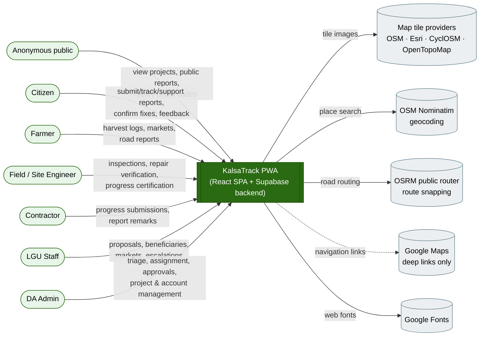
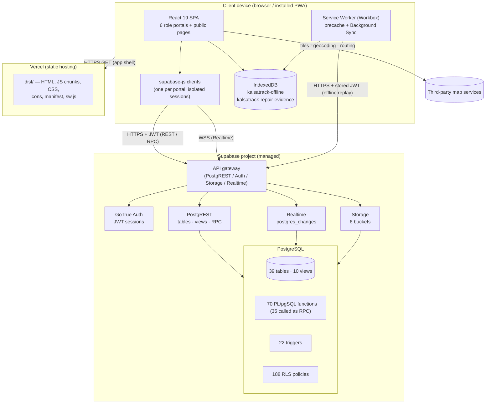
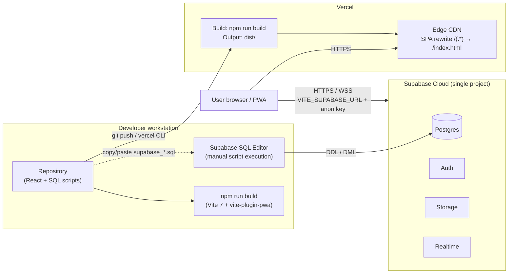

# KalsaTrack — System Architecture

**System:** KalsaTrack — Farm-to-Market Road (FMR) Transparency Portal
**Pilot site:** Municipality of Leon, Iloilo, Philippines
**Document set version:** 1.0 (generated 2026-10-13 from branch `feature/polygon-map`, base commit `22b5cd3` plus uncommitted working-tree changes)
**Method:** Static analysis of the repository only. No production system was connected to and no database statement was executed.

---

## 0. How to read this document set

| Document | Answers |
|---|---|
| **SYSTEM_ARCHITECTURE.md** (this file) | What the system is, who and what it talks to, how it is deployed |
| [SOFTWARE_ARCHITECTURE.md](SOFTWARE_ARCHITECTURE.md) | How the code is organised, the roles, and how authentication, authorization, validation and offline mode work |
| [DATABASE_ERD.md](DATABASE_ERD.md) | Tables, relationships, views, RPC functions, triggers, RLS and storage |
| [SYSTEM_WORKFLOWS.md](SYSTEM_WORKFLOWS.md) | End-to-end workflows as data-flow, sequence and state diagrams |
| [ARCHITECTURE_REVIEW.md](ARCHITECTURE_REVIEW.md) | Strengths, weaknesses, risks, technical debt and recommendations |

### Evidence labels

Every substantive statement carries one of these labels:

| Label | Meaning |
|---|---|
| **[Verified]** | Read directly from source code or SQL in this repository; a file path (and line number where practical) is cited. |
| **[Inferred]** | A reasonable conclusion drawn from verified evidence that the repository cannot prove by itself (e.g. what is actually deployed). |
| **[Recommendation]** | The author's suggestion; not part of the current system. |

> **Important limitation.** The database is defined by 80 loose `supabase_*.sql` scripts in the repository root, run by hand in the Supabase SQL editor. There is no ordered migration history, so the **live** schema may differ from what the scripts describe. Where a function or policy is redefined in several scripts, this document describes the most recent version by file date and flags the ambiguity. See [ARCHITECTURE_REVIEW.md §4](ARCHITECTURE_REVIEW.md#4-findings).

---

## 1. System overview

### 1.1 Problem and purpose

KalsaTrack makes public spending on farm-to-market roads (FMRs) visible and checkable. It lets:

- **citizens** report road problems with geotagged photo evidence and follow each report to resolution;
- the **Department of Agriculture (DA) office** (admin) triage reports, dispatch field engineers, manage FMR projects, approve contractor progress and release payment tranches;
- **field (site) engineers** inspect reported sites and certify contractor accomplishment on location;
- **contractors** report physical progress against a finalized Work Plan;
- **LGU staff** propose new FMR projects, manage farmer beneficiaries and markets, and act on escalated reports;
- **farmers** log harvests, see nearby FMRs and markets, and report road problems.

**[Verified]** The PWA manifest names the product "KalsaTrack - FMR Transparency Portal" with the description "Track Farm-to-Market Road Infrastructure with Full Transparency" ([vite.config.js:24-26](../../vite.config.js#L24-L26)).

### 1.2 Objectives as reflected in the implementation

| Objective | Where the code delivers it |
|---|---|
| Transparent project information for the public | Anonymous pages `/` and `/reports` ([src/App.jsx:87-98](../../src/App.jsx#L87-L98)); `public_reports_citizen_view` granted to `anon` ([supabase_public_report_workflow_rls_hardening.sql:317](../../supabase_public_report_workflow_rls_hardening.sql#L317)) |
| Credible, tamper-evident field evidence | GPS-tagged photos, watermark and QR code, SHA-256 fingerprint registered on the server ([src/lib/photoAttestation.js](../../src/lib/photoAttestation.js), [supabase_photo_attestations.sql](../../supabase_photo_attestations.sql)) |
| Accountable, auditable workflows | State-machine RPC functions with role checks and append-only activity logs ([supabase_public_report_workflow_rpcs.sql](../../supabase_public_report_workflow_rpcs.sql), [supabase_public_report_workflow_foundation.sql](../../supabase_public_report_workflow_foundation.sql)) |
| Pay only for verified work | Contractor submission, then engineer certification, then admin approval, then tranche release gated on verified progress ([supabase_progress_workflow_integrity_migration.sql:335-376](../../supabase_progress_workflow_integrity_migration.sql#L335-L376)) |
| Works in rural areas with poor connectivity | Installable PWA, IndexedDB offline queues, Background Sync ([src/sw.js](../../src/sw.js), [src/lib/offlineSync.js](../../src/lib/offlineSync.js)) |
| Data-informed planning | Admin and LGU analytics, heat maps, priority scoring, road network gap analysis ([src/components/admin/](../../src/components/admin/), [src/components/lgu/](../../src/components/lgu/), [src/lib/priorityScoring.js](../../src/lib/priorityScoring.js)) |

### 1.3 Scope boundaries

- **[Verified]** Geographic data is seeded for Leon, Iloilo (`supabase_leon_*.sql`, [src/data/leonBarangays.js](../../src/data/leonBarangays.js), [src/data/leonRoadInventory.json](../../src/data/leonRoadInventory.json)).
- **[Verified]** No payment, SMS or e-mail-sending integration exists in the source. Notifications are in-app only (the `notifications` table plus Supabase Realtime, [src/components/NotificationBell.jsx](../../src/components/NotificationBell.jsx)). Password-reset e-mails come from Supabase Auth ([src/pages/AuthPage.jsx:134](../../src/pages/AuthPage.jsx#L134)).

---

## 2. System context

| External dependency | Purpose | Evidence | Status |
|---|---|---|---|
| Supabase (Postgres, Auth, Storage, Realtime) | The whole backend | [src/lib/supabase.js](../../src/lib/supabase.js) | **[Verified]** used |
| OpenStreetMap, Esri World Imagery, CyclOSM, OpenTopoMap tiles | Basemaps | [src/lib/basemaps.js](../../src/lib/basemaps.js) | **[Verified]** |
| Nominatim (`nominatim.openstreetmap.org/search`) | Place search box | [src/lib/placeSearch.js](../../src/lib/placeSearch.js) | **[Verified]** |
| OSRM (`router.project-osrm.org`) | Snapping drawn routes to roads | [src/lib/mapRouteUtils.js](../../src/lib/mapRouteUtils.js) | **[Verified]** |
| Google Maps | Outbound "get directions" links only, no API key | `google.com/maps/dir/` links in `src/` | **[Verified]** |
| Overpass API (3 mirrors) | Offline data-preparation scripts only, not called at runtime | [scripts/fetch_leon_osm_roads.mjs](../../scripts/fetch_leon_osm_roads.mjs) | **[Verified]** |
| Vercel | Static hosting | [vercel.json](../../vercel.json), `.vercel/project.json` (project `kalsatrack`) | **[Verified]** configuration; **[Inferred]** that production runs there |

---

## 3. High-level architecture

KalsaTrack is a **two-tier, serverless "thick client plus Backend-as-a-Service"** system. The browser application holds all presentation and most orchestration logic. **Supabase Postgres is the application server**: business rules, state transitions and authorization live in SQL functions, triggers and Row-Level Security (RLS) policies. There is **no custom server tier** and there are **no Supabase Edge Functions** (no `supabase/functions` folder and no `functions.invoke` calls in `src/`).

### 3.1 Layer responsibilities

| Layer | Responsibilities | Evidence |
|---|---|---|
| **Presentation (React)** | Routing, role-specific dashboards, forms, maps, charts, client-side validation and UX feedback | [src/App.jsx](../../src/App.jsx), [src/pages/](../../src/pages/), [src/components/](../../src/components/) |
| **Client domain logic** | Pure calculation and formatting modules (progress, schedule, priority, analytics, report status) | [src/lib/](../../src/lib/) (55 modules, 19 test files) |
| **Client data access** | Direct table queries, RPC calls, storage uploads, realtime subscriptions | `supabase.from(...)`, `.rpc(...)`, `.storage`, `.channel(...)` across `src/`; [src/services/publicReportWorkflow.js](../../src/services/publicReportWorkflow.js) |
| **Offline layer** | Queue reports, engineer updates and repair evidence; replay with retries | [src/lib/offlineReports.js](../../src/lib/offlineReports.js), [src/lib/offlineSync.js](../../src/lib/offlineSync.js), [src/lib/offlineRepairVerifications.js](../../src/lib/offlineRepairVerifications.js), [src/sw.js](../../src/sw.js) |
| **Database (business tier)** | Enforces state machines, role and ownership checks, data invariants, audit logs, notifications | `SECURITY DEFINER` RPCs, triggers and RLS in `supabase_*.sql` |
| **Storage** | Photos and documents | 6 buckets (see [DATABASE_ERD.md §8](DATABASE_ERD.md#8-storage-buckets)) |

---

## 4. Deployment architecture

| Concern | Implementation | Evidence |
|---|---|---|
| Build | `vite build`; the PWA plugin runs only on `build` (`command === 'build'`), using `injectManifest` with a custom `src/sw.js` | [vite.config.js:9-20](../../vite.config.js#L9-L20) |
| Hosting | Vercel static output `dist/`, catch-all rewrite to `index.html` for client-side routing | [vercel.json](../../vercel.json) |
| Runtime configuration | Two build-time variables, `VITE_SUPABASE_URL` and `VITE_SUPABASE_ANON_KEY`, embedded in the bundle | [src/lib/supabase.js:3-4](../../src/lib/supabase.js#L3-L4) |
| Database provisioning | Manual: SQL scripts at the repo root, some with paired `_dryrun` and `_rollback` variants | e.g. [supabase_public_report_repair_actions_rollback.sql](../../supabase_public_report_repair_actions_rollback.sql) |
| Node version | `>=20` | [package.json](../../package.json) `engines` |
| Environments | **[Inferred]** A single Supabase project serves development and production; no environment-specific configuration or staging project is present | `.env` and `.env.local` only |
| CI/CD | **[Verified]** None in the repository (no `.github/`, no pipeline file). **[Inferred]** Vercel's Git integration or the CLI performs the deployment | — |
| Caching | Workbox precache of all built `js, css, html, ico, woff2, png, svg` up to 5 MB each; navigation fallback to the app shell | [vite.config.js:15-18](../../vite.config.js#L15-L18), [src/sw.js:22](../../src/sw.js#L22) |
| PWA install | Manifest: `standalone`, portrait, theme `#2a6a12`; update prompt (`registerType: 'prompt'`) | [vite.config.js:11,23-53](../../vite.config.js#L11) |

### 4.1 Runtime topology per request type

| Request | Path |
|---|---|
| Load the app | Browser → Vercel CDN (first load) → Service Worker cache (later loads) |
| Read data | supabase-js → PostgREST → Postgres (RLS applied as role `anon` or `authenticated`) |
| State change (workflow) | supabase-js `.rpc()` → `SECURITY DEFINER` function → validation, update, audit log and notification triggers |
| Upload photo | supabase-js Storage → bucket (storage RLS on `storage.objects`) |
| Live updates | Realtime WebSocket `postgres_changes` channels (≥15 channels, e.g. `notifications-${userId}`, `admin-public-reports-realtime`) |
| Offline submission | IndexedDB → (Background Sync `sync-offline-reports` or `online` event) → REST insert using the stored JWT ([src/sw.js:150-200,275](../../src/sw.js#L275)) |

---

## 5. Data-preparation toolchain (offline, developer-only)

**[Verified]** `scripts/` holds Node scripts that are **not** part of the runtime application. They prepare seed data and SQL:

| Script (npm alias) | Function |
|---|---|
| `osm:fetch` → [scripts/fetch_leon_osm_roads.mjs](../../scripts/fetch_leon_osm_roads.mjs) | Download Leon road geometry from Overpass |
| `gen:routes` → [scripts/generate_leon_route_corridors.mjs](../../scripts/generate_leon_route_corridors.mjs) | Generate project route corridors (outputs `supabase_leon_realistic_routes.sql`) |
| `verify:routes` → [scripts/verify_route_geometry.mjs](../../scripts/verify_route_geometry.mjs) | Audit route geometry against declared length |
| `inventory:repair` → [scripts/regenerate_leon_road_inventory.mjs](../../scripts/regenerate_leon_road_inventory.mjs) | Rebuild the road inventory SQL |
| `geocode_leon_farmers.cjs`, `sample_leon_farmers.cjs` | Geocode and sample farmer records (Nominatim) |

Root-level artefacts (`leon_*_audit.json`, `leonfarmers.xlsx`, `*.csv`) are inputs to or outputs of these scripts.

---

## 6. Inaccessible components and missing information

| Item | Why it matters | What was done instead |
|---|---|---|
| Live Supabase schema, policies and functions | Scripts may have been run partially, out of order, or superseded | The scripts were treated as the source of truth and redefinitions were flagged; read-only verification queries are provided in [ARCHITECTURE_REVIEW.md §7](ARCHITECTURE_REVIEW.md#7-read-only-verification-queries) |
| Supabase Auth settings (e-mail confirmation, password policy, rate limits, redirect URLs) | Affect sign-up security and the account-provisioning flow | Not documented; flagged |
| Supabase Realtime publication membership | Determines which tables actually broadcast changes | Client subscriptions documented; server publication unknown |
| Vercel project settings (environment variables, domains, headers) | Security headers and production URL | Only `vercel.json` documented |
| Creation of the `progress-photos` bucket | Its `INSERT INTO storage.buckets` is commented out ([supabase_contractor_migration.sql:127](../../supabase_contractor_migration.sql#L127)); the other five buckets are created in SQL | Presumed created through the Supabase dashboard as a public bucket **[Inferred]** |
| Scheduled jobs (pg_cron) or database webhooks | Could affect deadlines and alerts | No `cron.schedule` found in scripts; assumed none **[Inferred]** |
