# KalsaTrack — System Workflows

> Part of the KalsaTrack architecture set. See [SYSTEM_ARCHITECTURE.md §0](SYSTEM_ARCHITECTURE.md#0-how-to-read-this-document-set) for the evidence labels. Unless marked otherwise, every step below is **[Verified]** against the cited function or file.

| # | Workflow | Primary actors |
|---|---|---|
| WF-1 | [Citizen road report submission (online and offline)](#wf-1-citizen-road-report-submission) | Citizen, Farmer, Anonymous |
| WF-2 | [Report triage, inspection and resolution](#wf-2-report-triage-inspection-and-resolution) | Admin, Field Engineer |
| WF-3 | [Repair follow-up, verification and citizen confirmation](#wf-3-repair-follow-up-verification-and-citizen-confirmation) | Admin, Field Engineer, Citizen |
| WF-4 | [LGU escalation](#wf-4-lgu-escalation) | Admin, LGU |
| WF-5 | [Work Plan, contractor progress, certification and tranche release](#wf-5-work-plan-contractor-progress-certification-and-tranche-release) | Admin, Contractor, Site Engineer |
| WF-6 | [LGU project proposal](#wf-6-lgu-project-proposal) | LGU, Admin |
| WF-7 | [Staff and farmer account provisioning](#wf-7-staff-and-farmer-account-provisioning) | Admin, LGU |
| WF-8 | [Photo attestation and public verification](#wf-8-photo-attestation-and-public-verification) | All capturers, Public |
| WF-9 | [Notifications](#wf-9-notifications) | System |

---

## 0. Data flow diagrams

### 0.1 Level 0 (context)

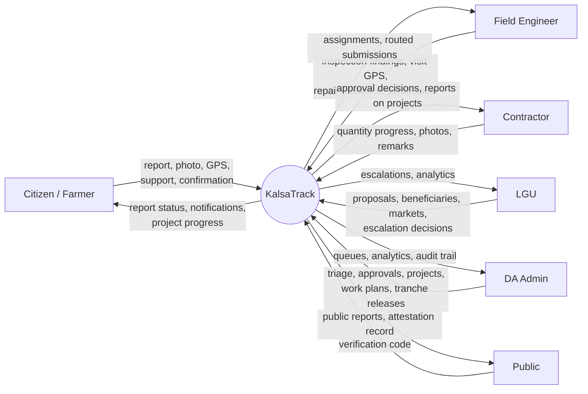

### 0.2 Level 1

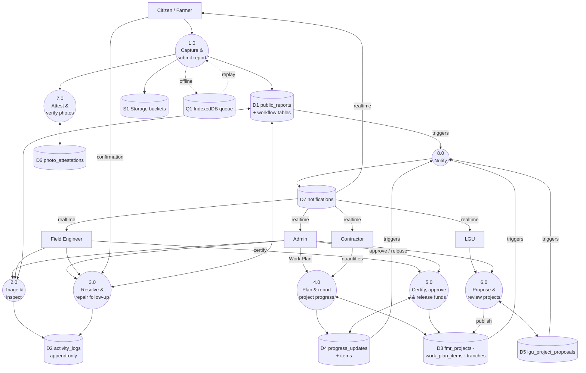

---

## WF-1. Citizen road report submission

**Entry points:** [src/components/PublicReportForm.jsx](../../src/components/PublicReportForm.jsx), used from the citizen and farmer portals. Steps: Locating → Picking (nearby project) → Classify → Reporting → Success ([src/components/publicReports/reportForm/](../../src/components/publicReports/reportForm/)).

**Rules:**

- A project counts as nearby within 250 m of its midpoint or 150 m of an endpoint, with a 1 km "wider" fallback ([src/lib/reportSubmission.js:9-11](../../src/lib/reportSubmission.js#L9-L11)).
- Required: category, description, photo, project, GPS ([:76-84](../../src/lib/reportSubmission.js#L76-L84)).

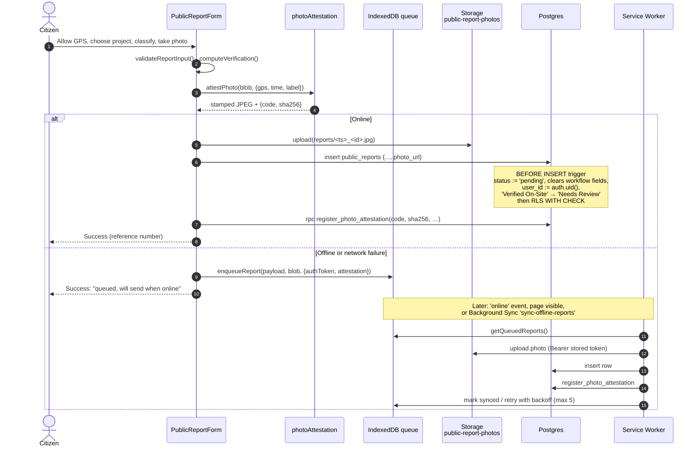

Evidence: [PublicReportForm.jsx:192-248](../../src/components/PublicReportForm.jsx#L192-L248), [src/sw.js:158-276](../../src/sw.js#L158-L276), [src/lib/offlineSync.js:11-13,200](../../src/lib/offlineSync.js#L11-L13), [supabase_public_report_workflow_rls_hardening.sql:77-121,369-385](../../supabase_public_report_workflow_rls_hardening.sql#L77-L121).

**Engagement after submission:**

- *Support* ("me too"): any signed-in citizen may support another person's report once (`public_report_supporters`, `citizen_can_support_report`). Milestones notify the reporter ([supabase_report_supporters.sql](../../supabase_report_supporters.sql)).
- *Tracking:* the citizen sees milestone timestamps only, through `public_reports_citizen_view` ([src/lib/useMyReports.js](../../src/lib/useMyReports.js), realtime).

---

## WF-2. Report triage, inspection and resolution

### 2.1 State model

A report has two linked status fields, `status` (admin lifecycle) and `engineer_status` (field lifecycle). The trigger `public_report_enforce_state_invariant` rejects invalid combinations ([…rls_hardening.sql:167-203](../../supabase_public_report_workflow_rls_hardening.sql#L167-L203)).

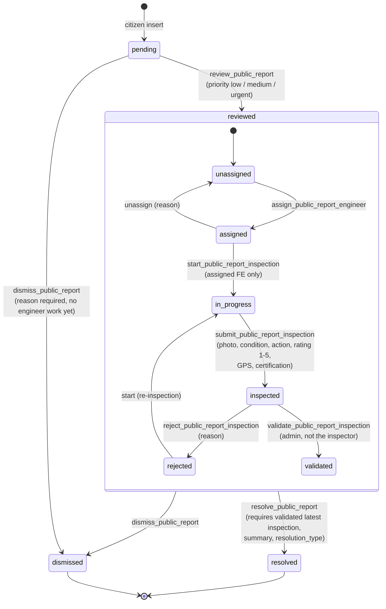

`resolution_type` ∈ `repaired`, `scheduled_for_repair`, `referred_to_contractor`, `monitoring_required`, `no_action_required`, `outside_project_scope`, `duplicate_case`, `other` ([supabase_public_report_workflow_rpcs.sql:59-68](../../supabase_public_report_workflow_rpcs.sql#L59-L68)).

### 2.2 Sequence

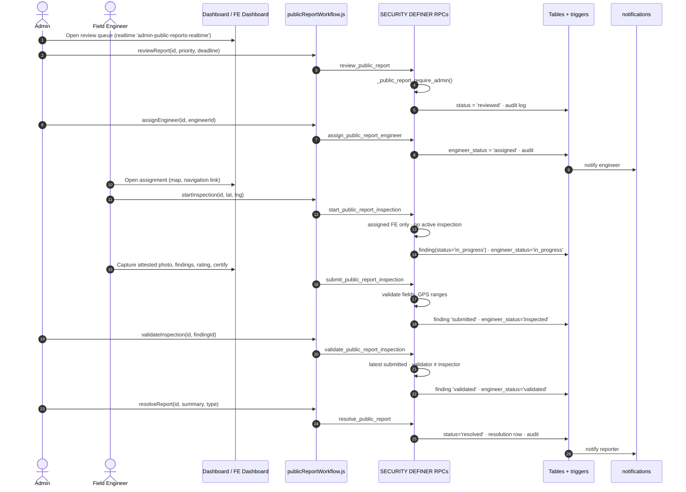

Evidence: [src/services/publicReportWorkflow.js](../../src/services/publicReportWorkflow.js), [supabase_public_report_workflow_rpcs.sql:224-1061](../../supabase_public_report_workflow_rpcs.sql#L224). Offline engineer actions are queued through `enqueueEngineerUpdate` ([src/lib/offlineReports.js:97](../../src/lib/offlineReports.js#L97)).

---

## WF-3. Repair follow-up, verification and citizen confirmation

**Purpose:** "resolved" records a **decision**. The repair-action table records whether the work actually **happened** ([supabase_public_report_repair_actions.sql:4](../../supabase_public_report_repair_actions.sql#L4)).

```mermaid
stateDiagram-v2
    [*] --> planned: plan_public_report_repair<br/>(resolution needs follow-up;<br/>party DA / LGU / contractor; target date ≥ today)
    [*] --> completed: plan_… when resolution_type = 'repaired'
    planned --> completed: complete_public_report_repair (note)
    completed --> verified: verify_public_report_repair<br/>after-photo + GPS ≤ 500 m<br/>assigned FE or admin<br/>verifier ≠ completer
    planned --> cancelled: cancel (reason)
    completed --> cancelled: cancel (reason)
    verified --> [*]
    cancelled --> [*]
```

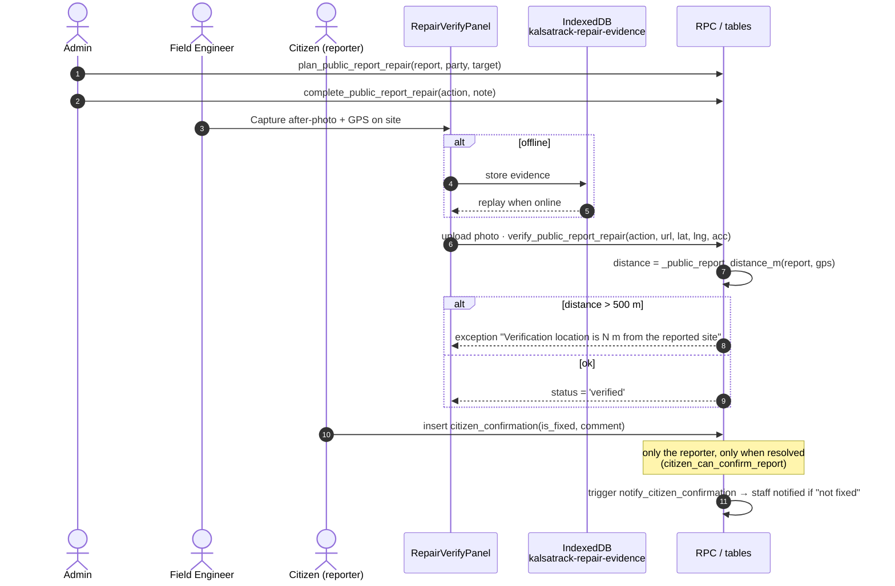

Evidence: [supabase_public_report_repair_actions.sql:208-567](../../supabase_public_report_repair_actions.sql#L208), [supabase_public_report_repair_verification_hardening.sql:58-150](../../supabase_public_report_repair_verification_hardening.sql#L58), [src/components/publicReports/RepairVerifyPanel.jsx](../../src/components/publicReports/RepairVerifyPanel.jsx), [src/lib/offlineRepairVerifications.js](../../src/lib/offlineRepairVerifications.js), [supabase_citizen_fix_confirmation.sql:32-84](../../supabase_citizen_fix_confirmation.sql#L32-L84).

---

## WF-4. LGU escalation

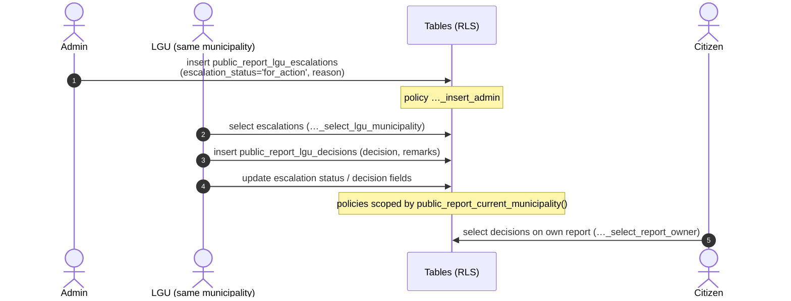

Evidence: [src/pages/Dashboard.jsx:2459](../../src/pages/Dashboard.jsx#L2459), [src/components/lgu/LguForActionTab.jsx:14](../../src/components/lgu/LguForActionTab.jsx#L14), [src/components/publicReports/LguEscalationPanel.jsx](../../src/components/publicReports/LguEscalationPanel.jsx), policies in [supabase_public_report_workflow_rls_hardening.sql:542-579](../../supabase_public_report_workflow_rls_hardening.sql#L542-L579). **[Inferred]** Escalation statuses observed in the UI: `for_action`, `more_info_requested`. No `CHECK` constraint on `escalation_status` was found.

---

## WF-5. Work Plan, contractor progress, certification and tranche release

### 5.1 State model

```mermaid
stateDiagram-v2
    direction LR
    state "Work Plan (fmr_projects.work_plan_status)" as WPS {
        [*] --> none
        none --> draft: save_work_plan_draft
        draft --> draft: save_work_plan_draft
        draft --> finalized: finalize_work_plan<br/>(captures adoption baseline;<br/>items locked by trigger)
    }
    state "Progress update (status / certification_status)" as PUS {
        [*] --> pending_routed: submit_progress_update_with_quantities<br/>(trigger routes to site engineer)
        pending_routed --> pending_certified: certify (validated quantities)
        pending_routed --> rejected_disputed: certify → disputed (remarks)
        pending_certified --> approved: approve_progress_update_admin
        pending_routed --> rejected: reject_progress_update_admin
        pending_certified --> rejected: reject_progress_update_admin
        approved --> [*]: immutable (trigger)
    }
```

### 5.2 Sequence

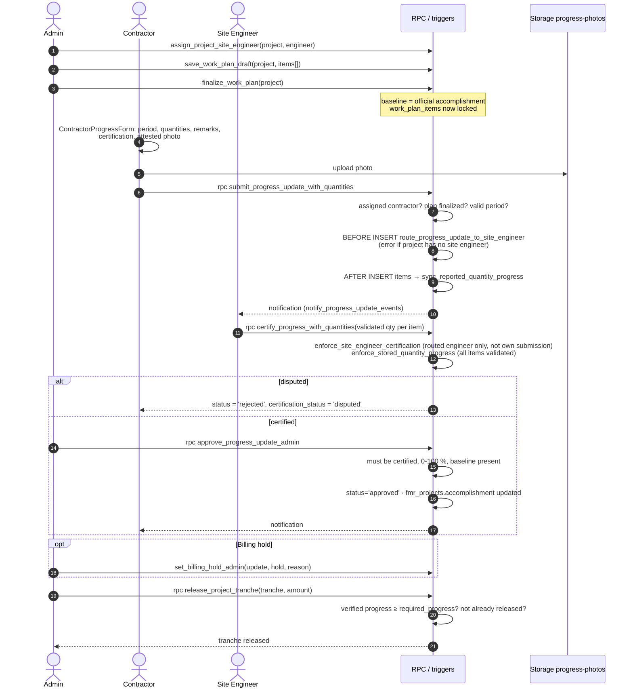

Evidence: [supabase_site_engineer_routing.sql:39-170](../../supabase_site_engineer_routing.sql#L39-L170), [supabase_work_plan_quantity_reporting_phase1.sql:82-473](../../supabase_work_plan_quantity_reporting_phase1.sql#L82), [supabase_final_workflow_security_hardening.sql:62-420](../../supabase_final_workflow_security_hardening.sql#L62-L420), [supabase_progress_workflow_integrity_migration.sql:102-376](../../supabase_progress_workflow_integrity_migration.sql#L102-L376), [src/pages/ContractorProgressForm.jsx:279-324](../../src/pages/ContractorProgressForm.jsx#L279-L324), [src/components/progress/QuantityCertificationReview.jsx](../../src/components/progress/QuantityCertificationReview.jsx).

**Segregation of duties enforced in the database:** the contractor submits, the routed site engineer certifies (and cannot certify their own submission), the admin approves, and the admin releases funds only above the progress gate.

---

## WF-6. LGU project proposal

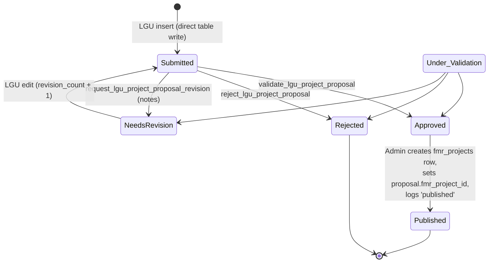

- **[Verified]** Approval does **not** create the project automatically. The admin creates the `fmr_projects` row through the normal project form and the client then links the proposal ([src/pages/Dashboard.jsx:3207-3230](../../src/pages/Dashboard.jsx#L3207-L3230)).
- **[Verified]** Submission and resubmission are direct table writes by the LGU ([src/components/lgu/LguProjectProposalsTab.jsx:436-469](../../src/components/lgu/LguProjectProposalsTab.jsx#L436-L469)). Because of the broad `lgu_project_proposals_rw` policy, these writes are not restricted by role at the database level (see review F-02).
- **[Inferred]** The `Under Validation` status exists in the `CHECK` constraint and the UI, but no code path that sets it was found.

---

## WF-7. Staff and farmer account provisioning

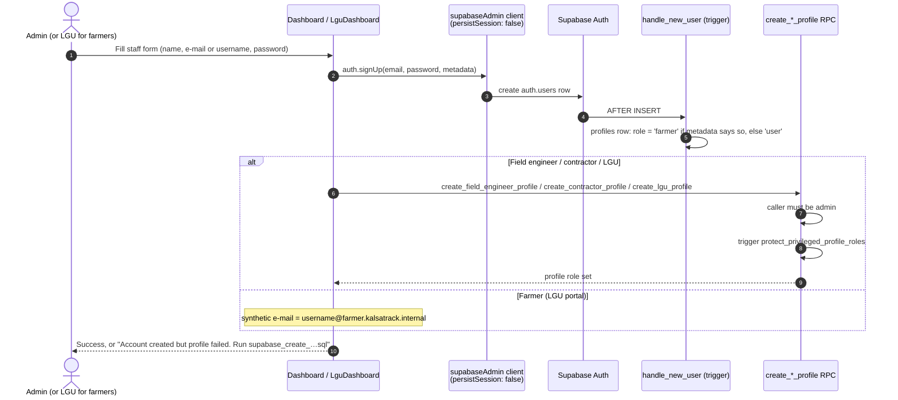

Evidence: [src/pages/Dashboard.jsx:8285-8667](../../src/pages/Dashboard.jsx#L8285), [src/pages/LguDashboard.jsx:973-1023](../../src/pages/LguDashboard.jsx#L973-L1023), [src/lib/farmerAuth.js](../../src/lib/farmerAuth.js), [supabase_farmer_profile_trigger_migration.sql](../../supabase_farmer_profile_trigger_migration.sql), [supabase_final_workflow_security_hardening.sql:430-472](../../supabase_final_workflow_security_hardening.sql#L430-L472).

**Note:** The two steps (sign-up, then profile RPC) are **not atomic**. If the RPC fails, an auth user is left with role `user`. The UI tells the admin to fix this manually.

---

## WF-8. Photo attestation and public verification

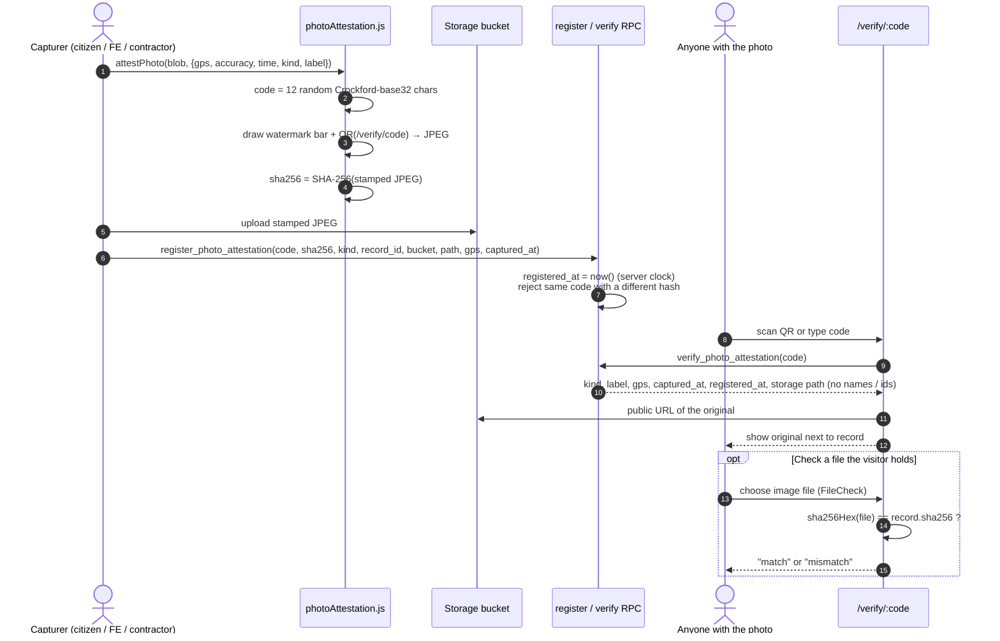

Evidence: [src/lib/photoAttestation.js](../../src/lib/photoAttestation.js), [supabase_photo_attestations.sql](../../supabase_photo_attestations.sql), [src/pages/VerifyPhotoPage.jsx](../../src/pages/VerifyPhotoPage.jsx), [src/App.jsx:94-95](../../src/App.jsx#L94-L95). Integrated into the citizen report, field inspection, repair verification and contractor progress paths, including offline replay ([src/sw.js:205-227](../../src/sw.js#L205-L227)).

**[Verified] Two levels of checking.** (1) Visual comparison with the stored original. (2) A cryptographic check: the visitor picks a file, the page computes its SHA-256 in the browser and compares it with the registered fingerprint ([src/pages/VerifyPhotoPage.jsx:43-70](../../src/pages/VerifyPhotoPage.jsx#L43-L70)). **[Inferred] Limitation:** any re-compression (for example by a messaging app) changes the hash. A "mismatch" therefore means "not the exact registered file", not necessarily "tampered"; the visual comparison covers that case.

---

## WF-9. Notifications

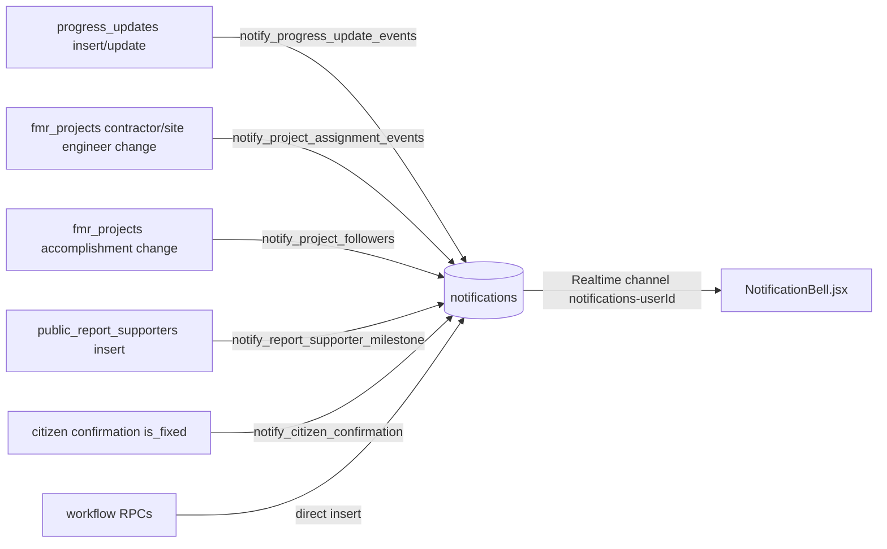

Evidence: trigger list in [DATABASE_ERD.md §7](DATABASE_ERD.md#7-triggers), [src/components/NotificationBell.jsx](../../src/components/NotificationBell.jsx). There is no push, e-mail or SMS delivery: users see notifications only while the app is open.
